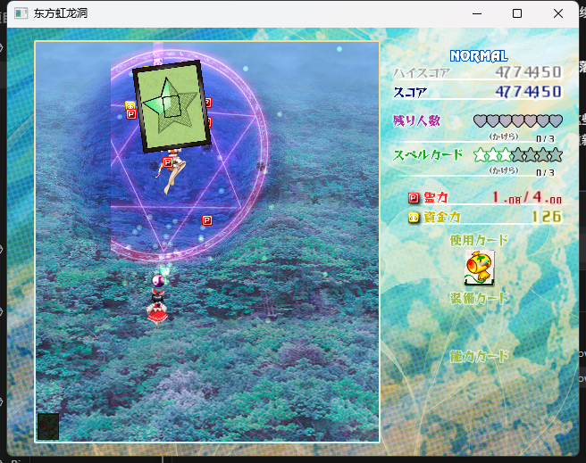
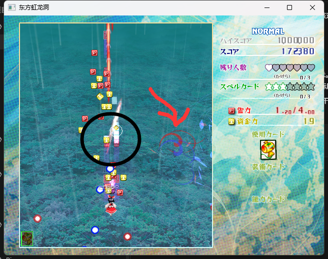
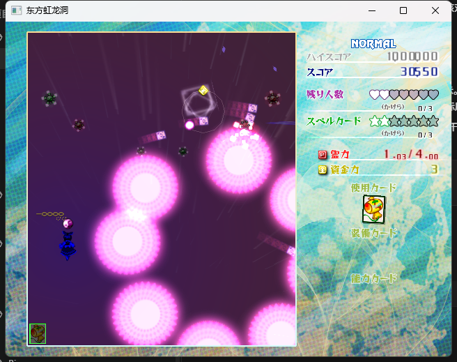
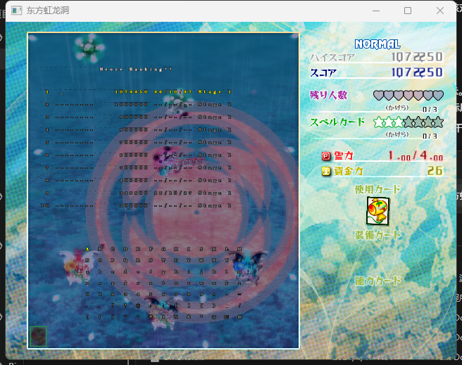

# 2026-10-27 实测问题与修复入口

用户在 `b88eea7`（`Restore native pickup lifecycle and shared ANM rendering`）之后实测，反馈以下 12 项问题。初次记录仅核查代码和资源。**后续已完成 01、02、03、04/11、05、06 及必要共用坐标链的源码修复与 Win32/x86 构建部署，待用户实测；追加的第 13 点敌弹坐标错位也已修复并构建部署。其余问题仍待修复。**

下面区分当前代码事实与待核对的原因。原版地址用于继续查函数，不代表本轮已逐条反编译确认。源码位置以该提交为准，后续优先按函数名查找。工具用法见 [toolchains.md](toolchains.md)；原版程序和资源位于本地 `toolchains/game18`，已解包资源位于 `toolchains/test-extract`。

## 01　掉落物仍然异常

**用户现象：** 图 1 中掉落物仍有问题，画面出现巨大、倾斜的绿色卡状图案。

- **已确认原因：** `446f40 → 409310` 创建 `abcard.anm` 脚本 14，并对其子脚本 15 使用卡牌表 `+0x30` 的小图 sprite；旧实现误取 `+0x2c` 大图。绿色 Bomb 碎片卡对应 item 17 / CardId 4：错用 `BOMB2_max`（sprite 12，256×320），原版为 `BOMB2_min`（sprite 13，64×80），造成宽高各放大四倍。
- **源码修复：** 四类卡牌掉落（item 16..19 / CardId 3..6）共用入口改取小图字段；保留脚本 15 的 0.3 缩放、根脚本 14 的 ±10° 摆动和发光子脚本。`CardInfo` 的两个旧字段名实际代表大/小图编号，已纠正注释。原版 `0x4b4020` 的全部 20 行道具映射与当前 `item_scripts` 一致；普通 P/资金、残机/Bomb、消弹点的脚本选择未改。
- **状态：** Win32/x86 构建通过，已部署至 `build/native/th18.exe`；未启动游戏，待用户确认第 1 点现象。

## 02　道中 Boss 出场后仍继续刷小怪

**用户现象：** 本应进入道中 Boss 交战，却继续出现增援。

- **已确认原因：** 原版 `437360/437b20` 将 `-9949/-9948/-9947` 映射到管理器 `+0x3c/+0x40/+0x44`（miss、Bomb/能力使用统计及脚本控制的无 miss/Bomb 标志）；重建版误映射到 `+0x48/+0x4c/+0x50` 的 Boss ID，导致 `MBoss` 在 `512(0)` 后立即覆盖登记。另一个独立错误是把原版 `430d30 case 6` 的条件生成指令 `309..312` 当成无条件生成，漏掉第 0 号 Boss 存在时跳过生成的分支。
- **原版时序：** `main` 生成 `MBoss`，等待 160 后进入 `MainLatter → MainSub05`。这里脚本继续计时，但 `MainSub05` 全部用 `309`，Boss 尚在就跳过各次生成；提前击破并执行 `512(-1)` 后，只有尚未走到的生成机会会执行，不补刷已跳过的敌人。该段结束再等 200，`520` 等待三个 Boss 槽全部释放，然后进入 `MainSub06`。原版没有“Boss 出场即冻结全局波次”的机制。
- **源码修复：** 恢复三个统计变量的读写地址及 `309..312` 的条件分支；登记槽移回敌机 `+0x636c`，按原版 `512`/析构的 Boss 标志清槽，补齐登记指令清除管理器 `+0x88` 位 0 的副作用。核对 `520` 的三槽等待、击破/超时脚本释放槽位及管理器持续推进时钟；保留原版按脚本决定的刷怪机会。
- **状态：** Win32/x86 构建通过，已部署至 `build/native/th18.exe`；未启动游戏，待用户确认第 2 点现象。

## 03　Boss 周围材质有明显截断

**用户现象：** Boss 周围有硬边。首次修改后用户再次实测：圆环左侧仍有竖直截断，周围应有的背景扭曲效果消失。

- **圆环截断：** `effect.anm:105` 是 layer 6 / type 8 的倾斜 3D 精灵，位于扭曲合成之后。`454b20/454950` 的 camera 3 原版离屏视口为 `(116,4,408,472)`，中心 X=320；重建版已把世界坐标映射到最终画面中心 X=224，却仍用旧视口。截图切口的画布 X=116 与此一致。现将 camera 3 视口及由其计算的透视眼点一同左移 96，得到 `(20,4,408,472)`；保留 30° 视角、近远平面和三轴旋转。
- **扭曲消失：** 上次恢复了 `42b1f0` 对条带指定的模式 0 alpha 混合，却漏掉其前置步骤 `455610`：先用 RGB ZERO/ONE 保留背景颜色，同时用独立 alpha ONE/ZERO 将场地区域 alpha 写满 255。背景自身的半透明 alpha 因而被再次乘进扭曲层，使效果淡化。现按原版补齐场景 alpha 写入，再取样完整场景并绘制 `42f890` 的 17×17 网格；圆外零 alpha 仍由网格控制。
- **保留机制：** 场景取样不使用暂停截图的缩小矩形；X=33..415、Y=17..463 的网格边缘限制、波动相位、颜色渐变、三维归一化及多个光环的创建顺序保持原版约定。
- **状态：** 本次补修已通过 Win32/x86 构建并部署至 `build/native/th18.exe`。此前版本已被用户实测否定；本次未启动游戏，截断与扭曲效果均待用户复测。

## 04　左侧敌机死亡，部分特效出现在右侧

**用户现象：** 图 2 黑圈内是死亡位置，红箭头下是偏移的部分特效。

- **已确认原因：** 原版 `430240` 直接把敌机世界坐标写入 VM `+5f0`。旧实现预加 `(224,16)`，而 `effect.anm` 主脚本 44 在第 0 帧执行 `304(20)` 后，绘制又加一次原点；圆环 46、3D 碎片 47 等子效果还使用了不同的父级位置组合。
- **源码修复：** 生产者恢复世界坐标；平面、圆环和 3D 特效统一按 `4063d0/4065a0` 换算位置。恢复 `+5bc` 根 VM 与 `+5c0` 直接父 VM 的区别、`4097d0` 根旋转及 `480160` 的 3D 原点/旋转约定。500/501/502/503/505 设置根与直接父级，504/506 仍按 `488a40` 独立发射。依赖该共用路径的自机、子机、子弹、道具和卡牌效果同步移除生产者预加原点，行为逻辑未改。
- **状态：** `ports/th18/portable/build.cmd` 构建通过，已输出至 `build/native/th18.exe`；未启动游戏，待用户确认第 4 点现象。

## 05　新开游戏错误地使用复活上升动画

**用户现象：** 新局不是重生，不应从屏幕底部上来。

- **已确认原因：** `45a7a0` 构造自机时确实为 `(0,400)` / state 0，但 `443e60` 与 `4443c0` 在正式开始时都会调用 `45abb0`，把自机切为正常 state 1。重建版只实现构造，漏了正式开局重置，因此首个逻辑帧进入 `45be90` 的 state 0，将 Y 改为 480 并执行 60 帧复活上升。
- **源码修复：** 在 `stage_session_start`、录像开局状态恢复及 main ECL 创建之前补回 `player_stage_start`。按 `45abb0` 重置射击/状态/聚焦计时、子机标签及重建、轨迹、移动和拾取/判定参数，再调用已有卡牌 slot-8 逻辑恢复卡牌覆盖值。普通开局保留构造位置 `(0,400)`；录像随后恢复录像位置。新局、跨关、练习和重试共用此入口，死亡确认后的 state 2 → state 0 上升与无敌流程保留。
- **状态：** Win32/x86 构建通过，已部署至 `build/native/th18.exe`；未启动游戏，待用户确认第 5 点现象。

## 06　主动卡使用闪烁与冷却显示缺失

**用户现象：** 右侧主动卡使用时不闪烁，冷却时看不出状态。

- **已确认原因：** `408640 → 408890` 对左下角选中卡使用子脚本 **2/3**，对右侧主动卡使用 **9/7**。2/9 是进度边框，3/7 是随进度裁切的前景图案；4/6 为底图。旧文档将左下角 2/3 视为可疑配对的推测不成立。实际错误是右侧使用了 8/9，未裁切覆盖在上面的图案 7；同时缺少根 VM 的就绪/冷却标签 2/3，且用改 sprite 高度的方式代替原版变换字段。
- **源码修复：** 恢复 2/3、9/7 两组调用及标签切换；按卡对象 `+0x3c` 浮点剩余冷却 / `+0x48` 上限计算进度，将它写入 ANM `scale_y`、`uv_scale_v`，UV 偏移为 `0.625*(1-progress)`。右侧两层按累积 Z 角共同偏移 `40*(1-progress)`，左下角保持原版底部锚点。发动标志来自卡对象 `+0x50` 位 5，发动期间满进度并按卡管理器 `+0x48` 时钟每四步三红一白；就绪变绿，冷却期间按进度着色。
- **更新链：** 显示在 A0x16 卡效果之后更新，再执行卡牌 ANM；时钟随游戏速度推进并跨关保留。每个右侧图标保存其实际卡对象，空卡不占图标索引，重复卡分别读取各自冷却；切换选中卡仍使用原版 3/4 换图路径。
- **状态：** Win32/x86 构建通过，已部署至 `build/native/th18.exe`；未启动游戏，待用户确认发动闪烁及冷却显示。

## 07　卡顿，并缺少原版右下角 FPS

**用户现象：** 有明显卡顿，要求移植原版 FPS 显示。

- **FPS 原版机制：** `4728a0` 在 Present 后统计；计时窗口达到 1 秒时，将此前累积帧数除以实际耗时写入 `FpsCounter+0x30`，随后把当前帧计入新窗口。`43a340` 在 B0x52 使用 ASCII 样式 1，于 `(588,470)` 输出 `%2.1ffps`（格式化前加 0.05）；低于 30 / 40 分别用 `ff5050ff` / `ffa0a0ff`，其他为白色，状态 4/15 不显示。原程序实际实例指针为 `4cf2dc`；此前记录的 `57049c` 是线程句柄，不是 FPS 对象。
- **源码修复：** 主循环改为上述一秒窗口统计，补齐绘制任务及销毁。录像写入继续按每 30 逻辑帧记录 FPS，但取值改为与右下角一致的统计结果；右下角显示当前运行速度，不用历史录像 FPS 替代。
- **已修正的渲染开销：** Boss 扭曲曾每帧调用 `D3DXLoadSurfaceFromSurface`，从 DEFAULT 渲染目标复制到 MANAGED 纹理。现按原版 `455610/455530` 的 GPU 合成方式，在第二张 DEFAULT 渲染纹理内完成全画面取样，消除这条每帧跨内存复制路径。保留 alpha 写满、逐像素 RGB/alpha 取样、扭曲网格及绘制顺序；新纹理随现有设备 Reset/退出流程释放和重建。
- **后续性能修复（用户指定排查项 1–3）：** 按 `4888f0/4890b0` 改为直接维护子节点链，更新、标签传播、查找和删除只访问实际子节点；独立托管对象直接记录链表身份，释放已知 VM 直接摘除绘制节点。移除原先 1024 槽登记表及其分配/删除扫描，模板切换保留端口持有的子节点和托管关系。按原版新节点头插顺序连接子链，绘制队列顺序保持不变。
- **批量提交：** 按 `47dce0/47e730/47e800`，在 ANM 分层绘制与敌弹绘制中，将连续的 type 0..3 屏幕精灵展开为六顶点三角形列表；纹理、混合、过滤或寻址模式变化时提交，遇到 3D/特殊图元、自定义回调及 pass 结束时先提交。保留半透明顺序，不按材质重排；批量路径不再逐精灵设置 D3D 状态。顶点容器复用已有容量。
- **同步日志：** 移除战斗中的按键变化日志和逐敌机生成日志，避免这些事件在主线程反复打开、写入、关闭 `log.txt`；资源加载和故障日志保留。
- **状态与待确认：** Win32/x86 构建通过，已部署；未启动游戏、未采集耗时。FPS、GPU 取样及上述三项开销已修复，整体流畅度和视觉表现仍待用户实测；本次未改动主循环等待或文字绘制机制。

## 08　关卡内 BGM 未正常出现

**用户原话：** “关卡内 BGM 没有接入。”

- **已确认原因：** `thbgm.fmt` 每条记录为 52 字节，其中 `+0x20` 是 18 字节 WAVEFORMATEX、`+0x32` 为两字节填充。旧 `BgmWaveFormat` 按 C++ 默认对齐变为 20 字节，连带 `BgmFmtEntry` 变为 56 字节；`load_tracks` 按错误的 sizeof 步长直接复制、索引，导致首条标题曲仍可读，但后续曲目错位。首关本应为 `th18_03.wav`，旧步长读成 `_03.wav`，并把采样率 44100 当成格式标签，无法建立正确播放缓冲。
- **源码修复：** 为文件结构明确使用单字节打包，恢复 18/52 字节布局。读取原始 FMT 的 18 条记录，核对曲目起点、前奏循环点、曲长和 PCM 格式；关卡、Boss、Extra、结局、Game Over 与音乐室均共用修正后的表。现有配置 BGM 已启用、音量 100，未改用户设置。
- **状态：** 本次修正的是可确定导致实际音频播放失败的格式错误；曲名提示是另一个显示问题，未把两者混同。Win32/x86 构建通过，已部署至 `build/native/th18.exe`；未启动或播放游戏，声音仍待用户实测。

## 09　右上角分数显示拥挤

**用户现象：** 高分/当前分数字符挤在一起，要求按原版实现。

- **已确认原因：** 原版 `41a2b0` 在右对齐/居中计算中减去数字宽 12、逗号宽 4（常量 `4b9434=-4`），绘制时则正向推进 12/4（`4b9248=+4`）。旧实现把对齐位移误作逗号宽度，测宽和推进均用 -4；HUD 每个逗号使整串文字压短 8 像素，并让后一位数字向回覆盖逗号。
- **源码修复：** 共用数字样式 4/5/10/11 按正宽度测量与推进；恢复数字逐字回到输入 Y、逗号固定下移 3 个屏幕像素（不随字号缩放）、空格沿用当前推进量，以及样式 5 的同组字模和点过滤。已核对 `419cb0/419dd0/419f30` 与 HUD 高分/当前分数/金额调用：数字 12 像素步长、前景 14×14/描边 16×16 原字模、右端 x=620 和现有 HUD 双倍虚拟坐标换算保留。
- **状态：** Win32/x86 构建通过，已部署至 `build/native/th18.exe`。未启动游戏，拥挤现象是否消失待用户实测；第 10 点排名/名字输入页仍单独处理。

## 10　死亡后的排名/输入名字界面错误

**用户现象：** 图 4 的排名表和名字输入区域表现异常，文字很小、间距不协调。

- **已确认原因：** 原版 `419390/41a2b0` 的普通 ASCII 字体使用原始 14 像素字模、独立 9 像素字符推进。旧绘制器把字模缩成半尺寸，并用字模宽度推进，导致排名列、八字名字与 9 像素光标不一致。`458090` 启用的 `+19240` 黑色半透明阴影也未绘制；Game Over 入榜时误把上次名字先写入新纪录，再叠画正在编辑的名字。
- **源码修复：** 恢复共用 style 0 的原版字号、固定字符推进、空格/换行及采样规则，按 `41a2b0` 实现 +2/+2 屏幕像素、半 alpha 黑色阴影；按 `458090/457bf0/457870` 恢复名字与字符表先画、排名行后画、新纪录名字留空直至确认、Credit 同页显示。保留原 13×7 字符表、18/16 像素网格、选中颜色与八字光标；按原 `4b4190` 表区分 Stage、Extra、Clear、ExClear，空纪录显示 Stage -；同时按原输入分支处理确认与取消同帧的优先级。
- **背景调用链：** 菜单打开经 `anm_copy_game_region` 复制战斗画面到 `text.anm` 59；`session_dispatch` 在 A0x10 根据暂停标志终止后续逻辑，STD 背景更新在 A0x12。此次保留这条已存在的静止背景与菜单动画链。
- **状态：** Win32/x86 构建通过，已部署至 `build/native/th18.exe`。未启动游戏，排名页显示及名字输入效果待用户实测；普通 ASCII 共用修复同时作用于使用该字体的其他菜单，不代表其他菜单整体已验收。

## 11　左侧放 Bomb，特效出现在右侧

**用户现象：** 左侧角色放 B，Bomb 特效偏到右侧。用户文字引用图 4；本次附件中图 3 更直接展示左侧自机与右侧大片 Bomb 效果，图 3/4 均保留。

- **已确认原因：** `pl00.anm` 的光球根脚本为 22/23，通过 500 创建 25/27/29 等子效果，根脚本执行 `304(20)`；37 是背景扩散圆。旧 `position_vm` 预加原点，使光球进入与 04 相同的重复平移链。原版 `421420/421590` 创建和更新 VM 均写世界坐标。
- **源码修复：** Bomb 按原版先绑定模板、写世界坐标，再执行初帧。所有机体共用的位置写入一并迁移；魔理沙 Beam 消弹位置按 `420f80` 经 `+5bc` 取世界坐标，不缩放、不加减画面原点。绘制共用 04 的坐标修复。
- **状态：** 已构建部署，未启动游戏，待用户确认第 11 点现象。

## 12　进入游戏时加载动画与原版不同

**用户现象：** 加载动画不同；用户猜测可能因为加载太快。

- **代码事实：** `core/app.cpp::app_begin_stage_loading`（102）创建 `effect.anm` 3..6 和 194，启动文字提示，并立即执行一次 `update_transition`。`anm_vm_set_script` 自身也执行初始更新。结束时切到 7..10；`update_transition`（40）依据动画完成/关闭计时销毁。`stage.cpp::session_dispatch`（610）控制资源完成后的开局时点。
- **初步方向：** 加载速度只是候选。还需查初始更新次数、转换任务顺序、关闭条件，以及 `draw_transition` 的遮罩/alpha 混合；不能直接强塞固定等待时间。
- **继续核对：** 原版 `406ad0` / `406c80` / `406d00` / `443e60`，结合 `effect.anm` 3..10、194 与 `ascii.anm` 17 的真实时间轴。

## 13　右侧小怪的弹幕显示在左侧（追加反馈）

**用户现象：** 右侧小怪发射的弹幕偏到左侧，原版应以小怪自身为中心。

- **已确认原因：** 共用坐标迁移已把敌弹 VM 的 `extra_x/y` 改为世界坐标，但漏了原版 `424fe0` 创建敌弹时对 VM `+0x538` 执行 `flags = (flags & ~0x200000) | 0x100000`。普通敌弹 ANM 脚本自身没有设置绘制层/坐标模式的指令，故图像缺少场地原点 `(224,16)`，呈现整体向左 224、向上 16 的错位；发射和碰撞仍使用原来的世界坐标。
- **源码修复：** 初次创建恢复原版场地坐标模式；`425c60` 的 ET200 变弹路径同样重新绑定模板、恢复 sprite 回调和场地模式，按原版只在颜色参数位 `0x8000` 置位时设置标签 2，然后由正常 ANM 更新执行。普通消弹沿用本弹 VM，坐标模式保持；分裂弹复用已修复的创建入口。没有给发射坐标重新硬加偏移。
- **状态：** Win32/x86 构建通过，已部署至 `build/native/th18.exe`；未启动游戏，待用户实测。

## 接手顺序

**01、02、03、04/11、05、06 已构建部署，待用户实测。** 后续按用户选定范围处理；**09/10** 合看文字约定。其余按编号逐项推进；**07 的原版 FPS 显示**可先做，供用户后续观察卡顿。

每个新对话以用户选定的问题为范围，遵守根目录 `AGENTS.md`：按原版完整机制修复、管理 Git；编译部署后由用户自行启动验收。

## 用户原始截图

以下为用户提供图片的原样保存，不是代理运行游戏所得。

### 图 1：异常掉落图案、Boss 周围截断

### 图 2：黑圈死亡位置与红箭头指向的偏移特效

### 图 3：左侧角色与偏右的 Bomb 效果

### 图 4：死亡后排名/名字输入界面

## 2026-10-28 补充：首关道中尾段至 Boss 战结束

- **原版流程依据：** `st01.ecl::main/MainLatter/MainSub06/MainBoss`、`st01bs.ecl::Boss/Boss1/BossCard1/Boss2/BossCard2/BossDead`、`default.ecl::EffChargePoint2/BossItem/Ecl_EtBreak2` 与 `st01a.msg`。尾波按脚本计时清场，随后等待 200 帧进入对话；MSG 的首次 ECL 信号放行 Boss 创建，Boss 等待 101 帧后切本体动画，再等对话结束开战。击破演出等待 60 帧后消弹、结算、掉落并注销 Boss；主脚本再等 60 帧进入战后对话与商店。保留这些原生等待，不改成“最后一只杂兵死后立即开战”。
- **入场特效缺失：** `EffChargePoint2` 使用 ECL319 旋转及 effect152..193 的 ANM508(1)，此前两条指令缺失。现按 `404fc0/405030/4058c0/405910` 补回 50 组、每组 3 个 effect150 与 1 个 effect151 的独立粒子，两段 Hermite 轨迹、视觉 RNG、颜色、标签停止发射及释放时终止粒子；同时恢复 ANM `+560` 独立经过时间，避免脚本等待导致第二段轨迹永不启动。
- **血量与无敌：** 原版两组总血量是 14100/14200；非符各需削减 12000，符卡余量为 2100/2200，阶段时限均 2100 帧。数值不改。ECL511 补齐 `+622c=HP*7` 和 Boss 血量标志；ECL515、伤害门与血环共用原 `+631c` Timer，替换独立整数倒数，保留构造时两帧保护及速度缩放。
- **超时误收卡：** 旧 `enemy_time_change` 只跳转脚本，仍保留符卡成功位。按 `42ed40` 补齐普通超时的失败位、奖励清零、超时音效标志与 Manager `+44` 清零；耐久符卡保留成功分支并清除超时掉落标志。击破/耐久超时同时恢复 `+6828` 的阶段统计结转。
- **Boss 倒计时遗漏：** 原 `42ed40` 写 Stage `+1b8/+1bc`，`43bb70/43cd00` 更新 ASCII2/3 秒位、百分秒、淡化、4/3/2 秒与 1/0 秒的颜色和提示音。此前只有隐藏坐标根，未更新或显示；现已接完整数字链。
- **清场不完整：** ECL518 按 `430d40` 从对话/普通弹/激光清理继续进入 525 敌人清理；ECL613 恢复 `4297a0` 的全场普通弹清理（含延迟弹）及 `449090(1)` 激光清理，区别于原先大半径、kind=0 的近似调用。
- **交付状态：** Win32/x86 构建通过并部署 `build/native/th18.exe`。主代理静态核对与实现；未启动游戏，入场视觉、血量体感、倒计时与结算由用户实测。范围是以上首关实际流程与涉及的共用分支，不代表所有关卡、机体和卡组已完成运行验收。

## 2026-10-28 补充：各关 Boss 共用减伤与已确认的脚本缺口

- **符卡减伤：** `430d40` 的 522/537/538/539 在 `42a320` 后开启 Enemy `+6238` bit0 并写 `+622c=HP*7`；523 在 `42a780` 后关闭，568 单独控制此位。恢复整条调用链及 `42ed40` 每次命中后更新的 `+6230` 阶段下界，保留累计整数扣血，不能换成逐次 `damage/7`。首关符卡 2100/2200 是原始 HP，不是已计入减伤的有效耐久。
- **二／三／六面弹幕：** 补齐 `425c60` 的 ET80000 附加漂移、ET8000000 生成直线／固定激光、ET40000000 追踪速度插值（`428460`），按 `423e10` 的顺序处理并发 ET。生成激光继承原 ET 表；后继条目提供长度、宽度、时间及游标。固定激光的高字节是 ET 游标，低字节是 flags，不能当标签。`424349..424407` 的漂移计时每帧重置、结束掩码 `0xfffffff6` 均经汇编核对，保留原版语义。
- **五面移动：** 409/411 共用原解释器 group 0x1b，分别对绝对／相对圆周运动的角速度、半径和径向速度插值；保留哨兵值与非正时长停止分支。
- **六面终符：** 恢复 `632(1) → 438d90` 的 Boss 圈外／自机圈内触发及 ET 游标 11 的转向；632 重置原回调状态，2/3 接现有激光边界派生敌人逻辑。317 递归发送动画标签，320 写动画附加坐标，并补齐 `42fe80` 的 14 槽位置合成、322 父槽位置及忽略偏移标志。ANM 标签回调在发送时执行，避免等待标签入口时重复触发。
- **阶段统计：** 570 按 `439eb0` 结转后清空对象计数；击破和耐久超时同写 `GameStatus +90`（原地址 `4ccd6c`），修正此前误写 `+ac`。
- **交付边界：** 本批修复上述已确认缺口；构建部署后由用户测试，不表示全部 Boss 弹型、特效和战斗已经完成 1:1 验收。

## 2026-10-28 续查：弹型坐标、激光与共用特效

- **六面发弹坐标：** `Boss1_at/BossCard5_at` 的 ECL94 原先被跳过。按 `48d0c8..48d206` 实现以参数4为旋转轴、参数5为横向比例的椭圆坐标，并保留角差归一化及双目标变量写入。
- **共用 ANM：** 实际资源缺失的 121/122/202/301/315/420 已补齐。effect150/151 的相等跳转影响入场粒子分层；enemy89..102 使用随机贴图；315 同时恢复 `+52c` 绘制颜色缓存和父色 `/128` 继承，覆盖颜色模式0/1/4；420 按原版两端切向量接现有 Hermite 插值器。位置插值共同遵循 `flags2 & 0x400` 的附加坐标目标。
- **直线／固定激光：** `4494f0` 有限 ET 跳转首次必须执行；`449e00` 反射使用设置时保存的速度、严格越界条件和单次音效。`44a4f0` 的末端裁短只在移动分支执行，出界检测先于倒计时递减。`44cae0` 跟随 Boss 分支替换原点后再加局部位移，不叠加两个世界坐标。545 清除的是原 `+758` 出界计时及消弹免疫，不是阶段计时。
- **Extra 曲线激光：** `44fb10/44ff80/44f450` 的角度归一化、尚未出生节点的方向／速度、首次有效采样与出界时点已对齐。`450340/480f70` 的条带 V 坐标应取贴图上下边界（旧实现误取 U），同时补回出生期尾部 VM、显隐条件及本对象采样状态，避免沿用上一绘制对象的过滤和寻址。
- **慢放期间的等待：** Extra 击破脚本使用速度0.25。普通弹 ET80000000/ET4000000、直线激光 ET80000000 改为原版浮点倒计时加整数到期判断；非正等待不启动效果。激光消弹免疫按原版整数逻辑步递减，区别于运动时间缩放。
- **范围：** 重新扫描1–6面与Extra的14份Boss／道中Boss ECL及其敌人、子弹、特效ANM，并修复以上确认差异；未运行游戏，不将指令覆盖或构建通过等同于所有战斗数值与画面已经1:1。

## 2026-10-28 续查：弹幕判定、发射器与阶段生命周期

- **普通弹方向与速度：** `425b40` 的方向参数同时服务 ET4、ET200000 和 ET10；三面使用1000000自机狙，五面使用3000000/4000000随机方向，六面使用5000000朝Boss，旧加速度分支将这些值当作弧度。补回完整参数区间与随机数消费，按 `427930/427b60` 区分向量模长和有符号标量速度，近零时保留方向；效果结束不再统一重建速度向量，ET20000 的原生恢复分支除外。ET8 恢复角度归一化。`428970` 的 ET100 是先递减后到期，包含根据画面四角判断出界弹能否重新入场的提前释放分支。
- **发射模式与回收：** `st07mbs/MBoss1_at` 实际使用模式10的6发×3层、17发×1层，旧实现仅有0–8模式。按 `424fe0` 补齐9–12及共有角度处理，恢复2000弹池上限、重合自机狙方向与 `427810` 发射后音效。按 `423e10` 恢复出生后5次更新内不做出界回收、先回收再更新动画，以及正常弹动画结束后的回收。
- **激光判定与消除：** `44f920` 用半段偏移后的点做曲线碰撞，命中后继续遍历并在末尾结算一次擦弹；`44a950/44ce80` 的擦弹计时只在擦弹分支递增，固定激光冻结查询仍受阶段限制。`44aca0/44bd00` 截断同步缩短最大长度，避免重新长回消除区域；`44d0f0/44e050` 保留固定激光的16像素残段及矩形/圆形各自边界规则。ET2000 转弹后的清除使用0类掉落。曲线路径克隆重连前驱；`448760` 删除旧尾节点时保留同帧反射/分裂追加的新节点。
- **激光动画：** 按 `4490d0/44c870/44ed70` 恢复 label2 初始化顺序、强制旋转/锚点/坐标标志、端点弹型分组及固定激光初始位置；绘制写原生位置字段，曲线尾端只绘制一次。`44e810` 的整条固定激光消除仅在原16像素画面余量内生成效果。
- **阶段生命周期：** `42e5a0` 按动画尺寸、曾进入画面标志及横/纵保留标志回收敌人，取代固定大矩形；检查发生在本帧ECL之前。514 的负血量仅停用该中断，不覆盖其余参数；518 的六面空白卡对话选择不排除录像回放。
- **未完成范围：** 本批关闭以上原函数已确认的差异，不作全部Boss战1:1结论。各符卡完整ET并行/串行组合、卡牌介入后的判定与阶段收尾仍需逐条核对；游戏运行与验收由用户负责。
